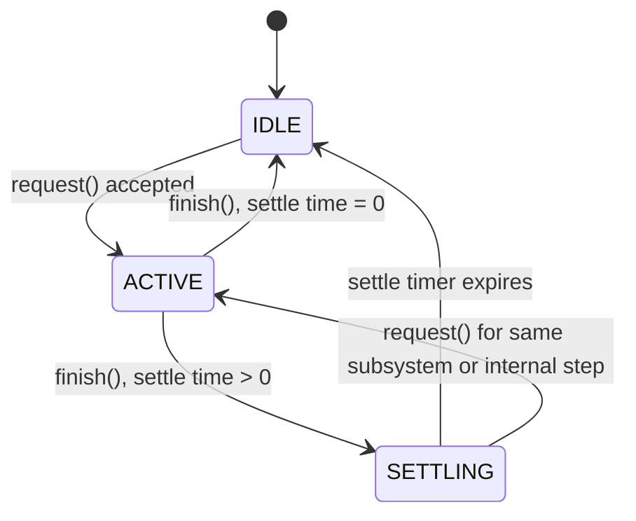
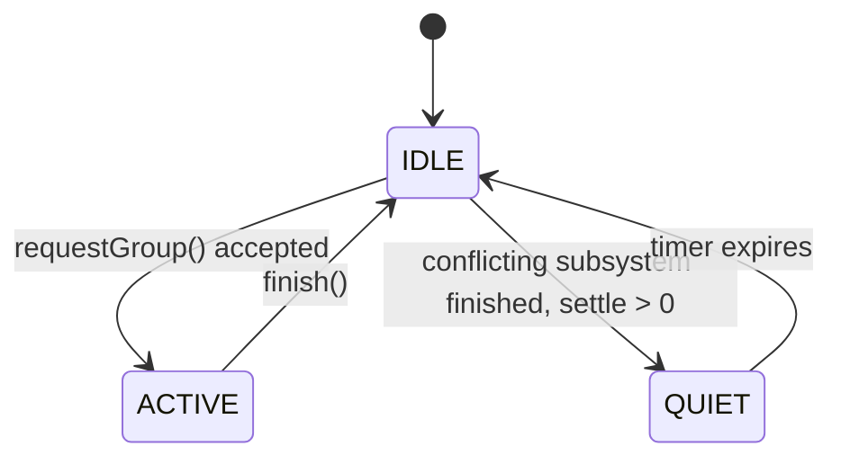

# Robot State Design: Q&A Session

Topic: designing subsystem, superstructure, and sequencer states for a robot with a speaker, 2 mics, and a chassis (Teensy).

---

## Q1: Initial question

> I have a robot having a speaker, 2 mics and chassis as three subsystems. Can you suggest subsystem and superstructures states in my robot?
>
> - robot can send a chirp and AFSK messages
> - robot can detect a chirp
> - robot can calculate the angle of the chirp from the source using TDOA
> - robot can decode AFSK and do what the message asks
> - robot can turn left, turn right, go straight, turn 180 degrees
> - robot send command such as stop chirp, turn off LED, send me an ACK immediately etc.
>
> robot does not activate two subsystems at the same time. It does not drive and send a chirp, or send a chirp and listen.
> robot does not have encoders for motors, it uses timer or gyro to determine the angle of rotation.
>
> What more info do you need to design states of subsystem and superstructures?

### A1

Here's a first-pass design, followed by the questions that would let me tighten it.

#### Subsystem states

**Speaker subsystem**
- `IDLE`: silent
- `SENDING_CHIRP`: emitting a chirp (single or repeated)
- `SENDING_AFSK`: modulating and transmitting a message frame
- `DONE`: transmission complete (momentary state, then back to IDLE)

**Mic subsystem (2 mics)**
- `IDLE`: not sampling
- `LISTENING`: sampling both mics, running chirp detection
- `CHIRP_DETECTED`: chirp found, holding the synchronized sample buffer
- `COMPUTING_TDOA`: cross-correlating the two channels and computing the angle
- `RECEIVING_AFSK`: demodulating a message frame
- `DECODING`: validating the frame (preamble, CRC) and parsing the command

Note that the mic subsystem is really two sub-activities, chirp detection and AFSK decoding. You could split it into two state groups or keep it as one subsystem with a mode.

**Chassis subsystem**
- `STOPPED`
- `DRIVING_STRAIGHT`: with a timer or duration
- `TURNING_LEFT`: with target angle and a timer or gyro
- `TURNING_RIGHT`
- `TURNING_180`
- `FAULT`: gyro timeout, etc. (optional)

For turns, each state has an internal condition: `elapsed_time >= T` (timer-based) or `|gyro_angle - target| < tolerance` (gyro-based). If you use the gyro, add a timeout as a safety exit.

#### Superstructure states

Since only one subsystem can be active at a time, the superstructure is essentially an arbiter that owns a single "who has the floor" state. Suggested states:

| Superstructure state | Active subsystem | Purpose |
|---|---|---|
| `IDLE` | none | Waiting for a trigger |
| `LISTENING` | Mic | Waiting for chirp or AFSK |
| `LOCALIZING` | Mic (compute) | TDOA calculation on the captured chirp |
| `DECODING_MESSAGE` | Mic | AFSK demod and parse |
| `EXECUTING_COMMAND` | Depends on command | Dispatch to a sub-sequence |
| `MOVING` | Chassis | Drive or turn |
| `TRANSMITTING_CHIRP` | Speaker | Send chirp |
| `TRANSMITTING_MSG` | Speaker | Send AFSK (command, ACK, etc.) |
| `SENDING_ACK` | Speaker | Priority transmit of an ACK (can be a variant of TRANSMITTING_MSG) |
| `ERROR` | none | Safe stop, recover to IDLE or LISTENING |

**Typical transitions**
- `IDLE → LISTENING` (start, or after any action completes)
- `LISTENING → LOCALIZING` (chirp detected) `→ MOVING` (turn toward source) `→ LISTENING`
- `LISTENING → DECODING_MESSAGE` (AFSK carrier detected) `→ EXECUTING_COMMAND`
- `EXECUTING_COMMAND → MOVING | TRANSMITTING_CHIRP | SENDING_ACK | (LED toggle, no subsystem)`
- Anything with a command that asks for an ACK: `→ SENDING_ACK → LISTENING`

**Mutual exclusion rule:** the superstructure only allows a transition into a state that activates a subsystem if the previously active subsystem has returned to IDLE first. Put that in the transition guards, not in the subsystems.

#### Design decisions worth making explicitly

1. **Persistent behaviors:** "stop chirp" implies chirping can be continuous. Since the robot can't listen while chirping, a repeating chirp should probably be a `CHIRP_BURST → LISTEN_WINDOW` duty cycle, or "stop chirp" can only be received between bursts.
2. **Command queue:** if a message contains multiple commands, or arrives during a move, do you drop it, queue it, or ignore it?
3. **LED:** it's not in the exclusion rule, so I'd treat it as a trivial subsystem or a side effect, not a superstructure state.

#### Information I need to refine this

**About behavior**
1. What is the robot's goal? (Follow a chirp source? Obey remote commands only? Both?)
2. Does the robot chirp periodically, or only on command?
3. After TDOA gives an angle, does it automatically turn toward the source, or just report the angle (via AFSK)?
4. Are commands ever chained (e.g., "turn left, then go straight 2 s")? Or one command per message?
5. Priority: if a command arrives mid-move, should it interrupt, queue, or be ignored? Does "stop" always preempt?

**About the protocol**
6. Is there a defined message format (preamble, command ID, parameters, CRC)? What are the command set and parameters (duration, angle)?
7. Is an ACK automatic for every message, or only when requested?
8. How is a chirp distinguished from AFSK (frequency band, duration)?

**About hardware and timing**
9. How long do chirp, AFSK transmission, and TDOA computation take? (Determines whether states are blocking.)
10. Is the speaker audible to the robot's own mics, i.e., do you need a deadtime after transmitting before listening?
11. Gyro vs. timer: is the gyro always present, or is the timer a fallback?
12. Does driving noise (motors) prevent listening? (This is probably why exclusion exists, and it implies you need a settle time after stopping.)

**About software architecture**
13. Is this a periodic loop (like a command-based or FSM tick) or event-driven? What microcontroller and RTOS, if any?
14. Do you want a hierarchical state machine where the superstructure commands subsystems by "requested state" and the subsystems report "at goal," or a flat one?

If you answer 1, 3, 5, 6, and 10, I can give you a concrete state diagram with exact transition conditions. The rest I can handle with reasonable defaults.

---

## Q2: Adding a sequence of tasks

> Let's say I want to add a sequence of tasks, what would be modified? For example, it listens to a chirp, gets TDOA, then turns 90 degrees, listens to the chirp and gets TDOA, then determines the direction, then moves 1 foot toward the source, then sends AFSK to turn off the chirp, etc.

### A2

Your subsystems barely change. The main addition is a new layer above the superstructure that runs ordered steps.

#### What changes

| Layer | Change |
|---|---|
| **Subsystems** (Speaker, Mic, Chassis) | Almost none. Each needs to report a result when it finishes: `SUCCESS`, `TIMEOUT`, or `FAIL` (e.g. no chirp heard in 5 s). |
| **Superstructure** | Stays the arbiter that enforces mutual exclusion. Its states become reusable primitives that take parameters (`TURN(angle)`, `DRIVE(distance)`, `LISTEN_FOR_CHIRP(timeout)`) and return a result. |
| **New: Sequencer** | Holds an ordered list of steps, an index, and shared data. It asks the superstructure to run one primitive, waits for the result, then advances, retries, or aborts. |

The hierarchy becomes **Sequencer → Superstructure → Subsystems**. The sequencer never touches subsystems directly.

#### Your example as a sequence

| # | Step | Primitive (active subsystem) | Output / next |
|---|---|---|---|
| 1 | Wait for chirp | `LISTEN_CHIRP` (Mic) | on timeout → abort |
| 2 | Localize | `COMPUTE_TDOA` (Mic) | store `θ1` |
| 3 | Turn 90° | `TURN(90)` (Chassis) | |
| 4 | Settle | `WAIT(t)` (none) | lets motor noise and vibration die down |
| 5 | Wait for chirp | `LISTEN_CHIRP` (Mic) | |
| 6 | Localize | `COMPUTE_TDOA` (Mic) | store `θ2` |
| 7 | Decide direction | `COMPUTE_BEARING` (none, pure math) | store `bearing` |
| 8 | Face source | `TURN(bearing)` (Chassis) | |
| 9 | Drive 1 ft | `DRIVE(1 ft)` (Chassis) | |
| 10 | Stop the chirp | `SEND_AFSK(STOP_CHIRP)` (Speaker) | |
| 11 | Confirm | `LISTEN_ACK(timeout)` (Mic) | on timeout → retry step 10 up to N times |
| 12 | Done | | → `IDLE` |

Step 7 is why the 90° turn is useful: two mics give only an angle relative to the mic baseline, with a front/back mirror ambiguity. Two measurements from different headings leave only one consistent candidate. Because that turn is gyro- or timer-based, its error feeds into the result, so use the gyro here if you can.

#### Specific modifications

1. **Primitives take goals and return results.** Instead of `TURNING_LEFT`, use `TURN(target_deg, timeout)`. The result is what lets the sequencer branch.
2. **Shared context (a "blackboard").** Steps need to pass data forward: `θ1`, `θ2`, `bearing`, retry counters, and the heading at each measurement. Keep this in the sequencer, not in the subsystems.
3. **Steps with no subsystem.** `WAIT` (settle time) and `COMPUTE_BEARING` occupy the superstructure but activate nothing. Add a settle step after any chassis motion and after any speaker output so the robot doesn't hear itself or its motors.
4. **Failure policy per step:** `abort`, `retry(n)`, or `skip`. For example, a missed chirp might retry twice before aborting, while a missed ACK retries the AFSK send.
5. **Abort and preemption.** An incoming `STOP`, or a sequence-cancel command, must be able to interrupt the sequence and force the chassis to `STOPPED`. Decide which commands are allowed mid-sequence. Since the robot can't listen while driving, "stop" can only be heard between steps, so say so explicitly.
6. **Sequences as data.** If an AFSK command can be "run homing sequence", the decoder just loads a sequence ID. You can define sequences as a table of steps, so adding new ones doesn't require new state-machine code.

#### Minimal structure

```
Sequence = [Step, Step, ...]
Step = { primitive, params, on_success, on_fail: ABORT|RETRY(n)|SKIP }

loop:
  step = seq[i]
  superstructure.request(step.primitive, step.params, ctx)
  wait until superstructure reports result
  if SUCCESS: i++
  else: apply step.on_fail
```

The sequencer's own states are just `IDLE`, `RUNNING(step i)`, `ABORTING`, `DONE`, and `FAILED`.

#### Questions that affect this

1. When a step in the middle of the sequence fails, should the robot stop where it is or return to a safe state?
2. Is "1 foot" timer-based? That needs calibration of speed against battery voltage and surface.
3. After the stop-chirp AFSK, must the robot confirm that the chirp actually stopped (by listening again), or is the ACK enough?

If you tell me whether sequences are hard-coded or loaded from AFSK commands, I can sketch the actual state diagram and message format for `RUN_SEQUENCE`.

---

## Q3: Why have a superstructure if there is a sequencer?

> Sequencer → Superstructure → Subsystems is the hierarchy. If I have a sequencer, what's the point of having a superstructure? Show a brief code layout showing how the Superstructure acts as a safety wrapper around a Sequencer step command to ensure your "no simultaneous subsystems" rule is never broken.

### A3

The sequencer answers "what comes next?" The superstructure answers "is it safe to do that right now?" They are different jobs, and the second one has to hold no matter who is asking.

The sequencer is not the only thing that wants to use subsystems. An incoming AFSK `STOP`, a one-off `SEND_ACK`, a chirp-triggered reaction, or a second sequence can all ask for the speaker or chassis. If the exclusion rule lives in the sequencer, every one of those paths has to remember to enforce it. If it lives in the superstructure, there is one choke point, and the subsystems are private, so nobody can bypass it.

If you only ever have one sequence runner and no other command sources, you can merge the two layers. Once you have more than one source of commands, you want the wrapper.

#### Code layout

```cpp
enum class Owner  { NONE, SPEAKER, MIC, CHASSIS };
enum class Result { RUNNING, SUCCESS, TIMEOUT, FAIL, REJECTED, ABORTED };

struct Primitive { Owner needs; /* type, params, timeout */ };

class Superstructure {
public:
    // The ONLY entry point for starting work. Sequencer, AFSK handler, etc. all call this.
    bool request(const Primitive& p) {
        if (owner_ != Owner::NONE)          return false;  // someone is active
        if (settling())                     return false;  // quiet period after last owner
        if (p.needs != Owner::NONE && !subsystem(p.needs).isIdle()) return false;

        owner_ = p.needs;
        current_ = p;
        if (owner_ != Owner::NONE) subsystem(owner_).start(p);
        return true;
    }

    // STOP bypasses the queue but still goes through the same release path.
    void emergencyStop() {
        if (owner_ != Owner::NONE) subsystem(owner_).abort();
        chassis_.stop();                     // always force motors off
        release(Result::ABORTED);
    }

    // Called every control tick.
    void update() {
        if (owner_ == Owner::NONE) return;
        Result r = subsystem(owner_).update();
        if (r != Result::RUNNING) release(r);
    }

    Result takeResult() { auto r = lastResult_; lastResult_ = Result::RUNNING; return r; }

private:
    void release(Result r) {
        // Don't free the floor until the subsystem is truly idle.
        subsystem(owner_).forceIdle();
        settleUntil_ = now() + settleTimeFor(owner_);  // motor noise / speaker ring-down
        owner_ = Owner::NONE;
        lastResult_ = r;
    }
    bool settling() { return now() < settleUntil_; }

    // Subsystems are private: no one outside can call chassis_.drive() directly.
    Speaker speaker_;  Mic mic_;  Chassis chassis_;
    Owner owner_ = Owner::NONE;
    Primitive current_;
    Result lastResult_ = Result::RUNNING;
    uint32_t settleUntil_ = 0;
};
```

```cpp
class Sequencer {
public:
    void update() {
        superstructure_.update();
        switch (state_) {
        case RUNNING_REQUEST:
            // May be refused; just retry next tick. No safety logic here.
            if (superstructure_.request(steps_[i_].primitive)) state_ = RUNNING_WAIT;
            break;
        case RUNNING_WAIT:
            Result r = superstructure_.takeResult();
            if (r == Result::RUNNING) break;
            applyFailurePolicy(r);   // advance, retry(n), or abort
            break;
        }
    }
};

// Other command sources use the same gate:
void onAfskCommand(Cmd c) {
    if (c == STOP) superstructure_.emergencyStop();
    else if (!superstructure_.request(toPrimitive(c))) queueOrDrop(c);
}
```

#### Why this enforces the rule

1. **Single owner variable.** `owner_` can only be set inside `request()`, which refuses if it is not `NONE`. Two active subsystems is structurally impossible, not just "avoided by convention."
2. **Subsystems are private.** There is no other path to `chassis_.drive()` or `speaker_.send()`.
3. **Release goes through one function.** `release()` forces the subsystem idle and starts the settle timer, so the robot never starts listening while motors or the speaker are still ringing.
4. **Emergency stop reuses the same path.** Preemption can't leave the system in a half-owned state.
5. **The sequencer stays simple.** A refused request is just "try again next tick." You can write a buggy sequence and the hardware rules still hold.

The same structure also gives you one place to add other safeties later, such as a maximum drive duration, a gyro-fault lockout, or a watchdog that releases an owner that has been active too long.

---

## Q4: Robot A and Robot B, Teensy code

> A robot does the sequence:
>
> **Robot A:** listens to a chirp, gets TDOA, then turns 90 degrees, listens to the chirp and gets TDOA, then determines the direction, then moves 1 foot toward the source, then sends AFSK to turn off the chirp.
>
> **Robot B:** sends a chirp for 0.7 sec, listens for AFSK for 2.3 sec, and if nothing is detected repeats the chirp-listen. If detected, does what the AFSK says and transitions to DONE.
>
> For robot A and B, are the only differences the sequence? Can you give me Teensy code for robot A and robot B? It does not have to be complete, I just want to see the setup and loop structure.

### A4

Mostly yes. The subsystems, superstructure, and sequencer engine can be identical firmware on both robots, and only the step table differs. Robot B needs two small additions to the engine:

1. **Branching on failure.** For A, a timeout means abort. For B, a timeout on `LISTEN_AFSK` is the normal path and means "go back to step 0." So the failure policy needs `GOTO(step)` alongside `ABORT`, `RETRY`, and `SKIP`.
2. **A step whose action comes from data.** B's "do what the AFSK says" isn't known at compile time. Add a primitive like `EXEC_RECEIVED_CMD` that reads the decoded command from the shared context and turns it into a real primitive at run time.

#### Shared code (same on both robots)

```cpp
// common.h
enum class Prim { WAIT, LISTEN_CHIRP, COMPUTE_TDOA, COMPUTE_BEARING,
                  TURN, DRIVE, SEND_CHIRP, SEND_AFSK, LISTEN_AFSK,
                  EXEC_RECEIVED_CMD };
enum class Result { RUNNING, SUCCESS, TIMEOUT, FAIL, REJECTED, ABORTED };
enum class OnFail { ABORT, RETRY, SKIP, GOTO };

struct Step {
  Prim     prim;
  float    param;       // angle, distance, or cmd id
  uint32_t timeout_ms;  // or duration for SEND_CHIRP / WAIT
  OnFail   onTimeout;
  uint8_t  gotoIdx;     // used if onTimeout == GOTO
};

struct Context {        // the "blackboard"
  float theta1, theta2, bearing;
  uint8_t rxCmd;        // decoded AFSK command
  uint8_t retries;
};
```

```cpp
// main.ino
#include "common.h"
#include "Superstructure.h"   // owns Speaker, Mic, Chassis (private)
#include "Sequencer.h"

#define ROBOT_A 1
#define ROBOT_B 2
#define ROBOT_ROLE ROBOT_A    // or read a jumper pin at boot

Superstructure sup;
Sequencer      seq(sup);
Context        ctx;

#if ROBOT_ROLE == ROBOT_A
const Step SEQ[] = {
  { Prim::LISTEN_CHIRP,     0,    10000, OnFail::ABORT, 0 },  // 0
  { Prim::COMPUTE_TDOA,     1,    200,   OnFail::ABORT, 0 },  // 1 -> theta1
  { Prim::TURN,             90,   3000,  OnFail::ABORT, 0 },  // 2
  { Prim::WAIT,             0,    300,   OnFail::ABORT, 0 },  // 3 settle
  { Prim::LISTEN_CHIRP,     0,    10000, OnFail::ABORT, 0 },  // 4
  { Prim::COMPUTE_TDOA,     2,    200,   OnFail::ABORT, 0 },  // 5 -> theta2
  { Prim::COMPUTE_BEARING,  0,    10,    OnFail::ABORT, 0 },  // 6
  { Prim::TURN,             NAN,  3000,  OnFail::ABORT, 0 },  // 7 NAN = use ctx.bearing
  { Prim::DRIVE,            1.0,  4000,  OnFail::ABORT, 0 },  // 8 feet
  { Prim::SEND_AFSK,        CMD_STOP_CHIRP, 1500, OnFail::RETRY, 0 }, // 9
};
#else  // ROBOT_B
const Step SEQ[] = {
  { Prim::SEND_CHIRP,       0, 700,  OnFail::ABORT, 0 },  // 0
  { Prim::LISTEN_AFSK,      0, 2300, OnFail::GOTO,  0 },  // 1 timeout -> step 0
  { Prim::EXEC_RECEIVED_CMD,0, 5000, OnFail::ABORT, 0 },  // 2 then DONE
};
#endif

elapsedMicros tick;
const uint32_t TICK_US = 1000;   // 1 kHz control loop

void setup() {
  Serial.begin(115200);
  sup.begin();                   // init pins, gyro, speaker DAC, mic ADC/DMA
  seq.load(SEQ, sizeof(SEQ) / sizeof(SEQ[0]), &ctx);
  seq.start();
}

void loop() {
  if (tick >= TICK_US) {
    tick -= TICK_US;
    sup.update();                // subsystems advance, settle timer, results
    seq.update();                // decides the next step
  }
  // AFSK/serial command sources go through the same gate:
  // if (rxFrameReady()) onAfskCommand(decode());   // -> sup.request() / sup.emergencyStop()
}
```

#### Sequencer core, showing the GOTO and DONE handling

```cpp
void Sequencer::update() {
  switch (state_) {
    case REQUEST:
      if (sup_.request(steps_[i_], ctx_)) state_ = WAIT;   // may be refused, so retry next tick
      break;

    case WAIT: {
      Result r = sup_.takeResult();
      if (r == Result::RUNNING) break;
      if (r == Result::SUCCESS) { advance(); break; }

      const Step& s = steps_[i_];
      switch (s.onTimeout) {
        case OnFail::GOTO:  i_ = s.gotoIdx; state_ = REQUEST; break;
        case OnFail::RETRY: if (++ctx_->retries < 3) state_ = REQUEST; else state_ = FAILED; break;
        case OnFail::SKIP:  advance(); break;
        default:            state_ = FAILED; break;
      }
      break;
    }
    case DONE: case FAILED: break;   // wait for a new sequence or reset
  }
}

void Sequencer::advance() {
  ctx_->retries = 0;
  if (++i_ >= n_) state_ = DONE; else state_ = REQUEST;
}
```

#### Notes for the Teensy

- **Sampling is not gated, results are.** Run mic sampling with DMA or the Audio library in the background. The superstructure only lets `LISTEN_*` steps consume those buffers, and flushes the buffer when a `LISTEN` step starts, so stale audio is never decoded.
- **B's timing.** The 0.7 s chirp plus 2.3 s listen gives a 3 s cycle. Decide whether the speaker ring-down settle time comes out of the 2.3 s listen window or adds to it. As written, the superstructure's settle delay is added between steps, which stretches the cycle slightly.
- **Robot B can still move.** Since `EXEC_RECEIVED_CMD` can turn into `TURN` or `DRIVE`, B keeps the chassis subsystem. If B will never move, you can compile it out.
- **Role selection.** A compile flag is simplest. A jumper pin read in `setup()` lets one binary serve both robots.

If you want, I can write the `Superstructure::request()` and `update()` bodies for the Teensy, including the settle timer and the gyro-based `TURN`.

---

## Q5: LISTEN_CHIRP as one state or three?

> LISTEN_CHIRP is made up of 3 steps (rough correlation, mix-FFT, find correlation). In this case do you recommend to separate them into three states or keep them under one state? Answer in one paragraph.

### A5

Keep them as one primitive (`LISTEN_CHIRP`) from the superstructure's and sequencer's point of view, but give the Mic subsystem an internal sub-state machine with three states. The three stages are a single pipeline on one data buffer and one subsystem, so nothing else can legally run between them, and exposing them upward would only force the sequencer to carry details it can't act on (it has no meaningful way to branch on "rough correlation passed"). Inside the Mic subsystem, though, separate states (`ROUGH_CORR → MIX_FFT → FINE_CORR`) pay off: each stage has a different cost, so a cheap rough correlation can reject noise early and skip the expensive FFT, each can be time-sliced across ticks so the 1 kHz loop never blocks, and each can have its own timeout and debug counters. The rule of thumb is that you should split states only when something outside the subsystem needs to observe or interrupt at that boundary. If you later need that, for example to abort mid-pipeline on a STOP or to log which stage rejected a candidate, expose a read-only `progress()` or `stage()` for diagnostics rather than promoting the stages to superstructure states. The primitive still reports a single result: `SUCCESS` with the detected chirp's timing and both channels' data, or `TIMEOUT` if no chirp is confirmed within the window.

---

## Summary of the architecture

```
Sequencer        what comes next? (step table, context, failure policy)
    |
Superstructure   is it safe right now? (single owner, settle timer, e-stop)
    |
Subsystems       Speaker / Mic / Chassis (private, report SUCCESS/TIMEOUT/FAIL)
                 Mic internal sub-states: ROUGH_CORR -> MIX_FFT -> FINE_CORR
```


---

## Q6: `Superstructure::request()` and `update()` implementations 

> Write the `Superstructure::request()` and `update()` bodies for the Teensy, including the settle timer and the gyro-based `TURN`.

This section covers `request()` and `update()` plus the helpers they depend on (`finish()`, `ownerFor()`, `settleMsAfter()`). The full source, including the gyro-based `Chassis::TURN`, is in `Superstructure.h` and `Superstructure.cpp`.

### Helpers used by `request()` and `update()`

```cpp
namespace cfg {
  constexpr uint32_t SETTLE_CHASSIS_MS   = 300;  // motor noise + vibration
  constexpr uint32_t SETTLE_SPEAKER_MS   = 150;  // speaker ring-down
  constexpr uint32_t SEND_CHIRP_GRACE_MS = 200;  // watchdog margin for SEND_CHIRP
}

static inline int idx(Owner o) { return (int)o; }

// Which subsystem does a primitive need? NONE = superstructure-only work.
static Owner ownerFor(Prim p) {
  switch (p) {
    case Prim::SEND_CHIRP:
    case Prim::SEND_AFSK:        return Owner::SPEAKER;
    case Prim::LISTEN_CHIRP:
    case Prim::COMPUTE_TDOA:
    case Prim::LISTEN_AFSK:      return Owner::MIC;
    case Prim::TURN:
    case Prim::DRIVE:            return Owner::CHASSIS;
    default:                     return Owner::NONE;   // WAIT, COMPUTE_BEARING, EXEC_RECEIVED_CMD
  }
}

static uint32_t settleMsAfter(Owner o) {
  switch (o) {
    case Owner::CHASSIS: return cfg::SETTLE_CHASSIS_MS;
    case Owner::SPEAKER: return cfg::SETTLE_SPEAKER_MS;
    default:             return 0;
  }
}

bool Superstructure::allSubsystemsIdle() const {
  for (int i = 1; i < idx(Owner::COUNT); i++)
    if (sub_[i] && !sub_[i]->isIdle()) return false;
  return true;
}
```

### `request()`

The only way to start work. Returns `false` meaning "not now, ask again next tick". Returns `true` meaning accepted; the outcome arrives through `takeResult()`.

```cpp
bool Superstructure::request(const Step& in, Context* ctx) {
  if (busy_) return false;                       // covers owner-less steps (WAIT etc.) too

  Step s = in;
  if (!resolve(s, ctx)) {                        // e.g. unknown received command
    ctx_ = ctx; active_ = in; owner_ = Owner::NONE; busy_ = true;
    finish(Result::FAIL);
    return true;                                 // accepted; result = FAIL
  }

  Owner need = ownerFor(s.prim);
  if (need != Owner::NONE) {
    // Quiet period: block a *different* subsystem from starting until the last one settles.
    if (settling() && need != lastOwner_) return false;

    // Invariant check: nobody may be active. If this ever fails, we have a bug elsewhere.
    if (!allSubsystemsIdle()) return false;
  }

  active_  = s;
  ctx_     = ctx;
  owner_   = need;
  busy_    = true;
  startMs_ = millis();
  uint32_t grace = (s.prim == Prim::SEND_CHIRP) ? cfg::SEND_CHIRP_GRACE_MS : 0;
  deadlineMs_  = startMs_ + s.timeout_ms + grace;
  lastResult_  = Result::RUNNING;

  if (need != Owner::NONE) sub_[idx(need)]->start(s, ctx);
  return true;
}
```

**How the settle timer works in `request()`**

- `finish()` sets `settleUntil_` when an owner releases, and `lastOwner_` records who it was.
- A request for a different subsystem is refused while `settling()` is true. For example, `LISTEN_CHIRP` cannot start until 300 ms after the chassis stops.
- A request for the same subsystem starts immediately, so a `TURN` followed by a `DRIVE` has no gap.
- `settling()` uses a signed subtraction, `(int32_t)(millis() - settleUntil_) < 0`, so it stays correct when `millis()` wraps.

### `update()`

Called every control tick (1 kHz). Never blocks.

```cpp
void Superstructure::update() {
  // Heading integration always runs. The gyro is a sensor, not an "active" subsystem.
  chassis_.tickHeading(micros());

  if (!busy_) return;
  uint32_t now = millis();
  Result r = Result::RUNNING;

  switch (active_.prim) {
    case Prim::WAIT:             // timeout_ms is the wait duration
      r = ((int32_t)(now - (startMs_ + active_.timeout_ms)) >= 0) ? Result::SUCCESS : Result::RUNNING;
      break;

    case Prim::COMPUTE_BEARING:  // pure math, finishes immediately
      r = computeBearing(*ctx_) ? Result::SUCCESS : Result::FAIL;
      break;

    default:                     // subsystem-owned primitive
      r = sub_[idx(owner_)]->update();
      if (r == Result::RUNNING && (int32_t)(now - deadlineMs_) >= 0)
        r = Result::TIMEOUT;     // watchdog: no primitive may run past its deadline
      break;
  }

  if (r == Result::SUCCESS && active_.prim == Prim::COMPUTE_TDOA) {
    // Mic stored theta1/theta2. Stamp the heading it was measured at.
    if ((int)active_.param == 1) ctx_->heading1 = chassis_.yawDeg();
    else                         ctx_->heading2 = chassis_.yawDeg();
  }

  if (r != Result::RUNNING) finish(r);
}
```

### `finish()`: the single release path

Success, timeout, failure, and emergency stop all end here, so the settle timer always starts and the hardware is always left safe.

```cpp
void Superstructure::finish(Result r) {
  if (owner_ != Owner::NONE) {
    Subsystem* sub = sub_[idx(owner_)];
    if (r != Result::SUCCESS) sub->abort();      // make hardware safe on any abnormal end
    sub->forceIdle();                            // never free the floor until truly idle
    settleUntil_ = millis() + settleMsAfter(owner_);   // start quiet period
    lastOwner_   = owner_;
  }
  owner_      = Owner::NONE;
  busy_       = false;
  lastResult_ = r;
}

void Superstructure::emergencyStop() {
  chassis_.forceIdle();                          // motors off no matter what
  if (busy_) finish(Result::ABORTED);
}

Result Superstructure::takeResult() {
  Result r = lastResult_;
  lastResult_ = Result::RUNNING;                 // one-shot
  return r;
}
```

### Design notes

1. **`busy_` vs `owner_`.** `request()` checks `busy_`, not `owner_`. Steps like `WAIT` and `COMPUTE_BEARING` have no subsystem (`owner_ == NONE`) but still occupy the superstructure. Checking only `owner_`, as in the earlier sketch, would let a second request start during a `WAIT`.
2. **Belt-and-braces invariant.** `allSubsystemsIdle()` re-checks every subsystem even though `busy_` should already guarantee it. If a subsystem ever fails to return to idle, the request is refused instead of two subsystems running together.
3. **Watchdog.** Every subsystem-owned primitive has a deadline of `timeout_ms`, plus a small grace for `SEND_CHIRP` (where `timeout_ms` is the chirp duration). A hung subsystem becomes `TIMEOUT`, which `finish()` turns into `abort()` and `forceIdle()`.
4. **Timing semantics.** For `WAIT`, `timeout_ms` is the duration, and the primitive reports `SUCCESS` when it elapses. For `LISTEN_*`, `timeout_ms` is a limit, and reaching it reports `TIMEOUT`. This is why Robot B's `LISTEN_AFSK` step uses `OnFail::GOTO` for its timeout.
5. **Heading stamp.** After a successful `COMPUTE_TDOA`, the superstructure records the chassis yaw in the context. `computeBearing()` uses these headings to combine the two TDOA angles and resolve the front/back ambiguity.
6. **Settle time and Robot B's cycle.** The settle delay adds to Robot B's 0.7 s chirp plus 2.3 s listen cycle. If you need exactly 3 s, shorten `SETTLE_SPEAKER_MS` or subtract it from the listen window.


---

## Q7: Does concurrent `LISTEN_CHIRP` + `TURN` change the superstructure state definition?

> If robot can do `LISTEN_CHIRP` and `TURN` at the same time, would you change the superstructure state definition?
>
> Superstructure states
> Since only one subsystem can be active at a time, the superstructure is essentially an arbiter that owns a single "who has the floor" state. Suggested states:
>
> | Superstructure state | Active subsystem | Purpose |
> |---|---|---|
> | IDLE | none | Waiting for a trigger |
> | LISTENING | Mic | Waiting for chirp or AFSK |
> | LOCALIZING | Mic (compute) | TDOA calculation on the captured chirp |
> | DECODING_MESSAGE | Mic | AFSK demod and parse |
> | EXECUTING_COMMAND | Depends on command | Dispatch to a sub-sequence |
> | MOVING | Chassis | Drive or turn |
> | TRANSMITTING_CHIRP | Speaker | Send chirp |
> | TRANSMITTING_MSG | Speaker | Send AFSK (command, ACK, etc.) |
> | SENDING_ACK | Speaker | Priority transmit of an ACK (can be a variant of TRANSMITTING_MSG) |
> | ERROR | none | Safe stop, recover to IDLE or LISTENING |

### A -- conflict matrix is needed

Yes, I would change it. The "who has the floor" state only works when exactly one subsystem can be active. Once `LISTEN_CHIRP` and `TURN` can overlap, that single state can no longer describe the robot.

#### What breaks

The old table mixes two kinds of things:

- **Subsystem activities:** `LISTENING`, `LOCALIZING`, `DECODING_MESSAGE` (Mic), `MOVING` (Chassis), `TRANSMITTING_*` (Speaker).
- **Whole-robot conditions:** `IDLE`, `ERROR`.

With one active subsystem, the two kinds can share one enum. With concurrency you would need combined values like `LISTENING_AND_MOVING`, and every new allowed combination adds more. That is state explosion, and it is the signal that you have merged things that should be separate.

#### What replaces it

Split the state into two levels:

1. **Each subsystem keeps its own state machine.** The old activity states move down into them.
2. **The superstructure state becomes the set of active subsystems, plus a health state.** Instead of one enum value, it is an `activeMask_` and a short list of robot-level states.

| Level | States | Notes |
|---|---|---|
| **Mic subsystem** | `IDLE`, `LISTENING`, `LOCALIZING`, `DECODING` | The old LISTENING / LOCALIZING / DECODING_MESSAGE |
| **Chassis subsystem** | `STOPPED`, `TURNING`, `DRIVING`, `FAULT` | The old MOVING, split by action |
| **Speaker subsystem** | `IDLE`, `SENDING_CHIRP`, `SENDING_AFSK` | The old TRANSMITTING_CHIRP / MSG / SENDING_ACK (an ACK is just an AFSK with priority) |
| **Superstructure** | `IDLE` (mask empty), `ACTIVE` (mask not empty), `ERROR` / `ESTOP` | Plus the `activeMask_` and a conflict rule |

`EXECUTING_COMMAND` was never a real robot state. It is dispatch logic, so it moves into the sequencer or command handler. `SETTLING` also changes, as described below.

With this split, "listening while turning" is not a new state. It is simply `activeMask_ = MIC | CHASSIS`, with the Mic in `LISTENING` and the Chassis in `TURNING`.

#### The rule changes from one owner to a conflict matrix

The single-owner check becomes "does the new subsystem conflict with any active one?":

| | Speaker | Mic | Chassis |
|---|---|---|---|
| **Speaker** | | conflict | allowed |
| **Mic** | conflict | | allowed only if the chirp survives motor noise |
| **Chassis** | allowed | depends | |

```cpp
enum Sub : uint8_t { SPK = 1 << 0, MIC = 1 << 1, CHS = 1 << 2 };

// Must be symmetric: if A conflicts with B, then B conflicts with A.
static uint8_t conflictsWith(Sub s) {
  switch (s) {
    case SPK: return MIC;      // speaker deafens the mics
    case MIC: return SPK;      // add "| CHS" if motor noise masks the chirp
    case CHS: return 0;        // add "| MIC" under the strict rule
  }
  return 0;
}

bool Superstructure::request(const Step& s, Context* ctx) {
  Sub need = subFor(s.prim);
  if (activeMask_ & need)                 return false;   // that subsystem is already busy
  if (activeMask_ & conflictsWith(need))  return false;   // acoustic conflict
  if (settleBlocks(need))                 return false;   // per-subsystem quiet timer
  activeMask_ |= need;
  sub(need)->start(s, ctx);
  return true;
}
```

The matrix is data. If a test shows the Mic can hear chirps over motor noise, you remove one entry, and no state definitions change.

#### Other things that change

- **Settle is no longer a global state.** After the Speaker releases, only the Mic needs a quiet period, not the Chassis. Keep a timer per subsystem, such as `micBlockedUntil_`, and check it in `settleBlocks()`.
- **Results become per subsystem.** `takeResult()` becomes `takeResult(Sub)`. Two primitives can finish at different times, and `finish()` clears only its own bit from the mask.
- **The sequencer needs a join.** Starting `LISTEN_CHIRP` and `TURN` together requires a parallel step: the group finishes when both finish, and you must choose what a failure of one does to the other (usually abort the other). This is WPILib's `ParallelCommandGroup`.
- **Emergency stop gets simpler and more important.** It aborts every active subsystem, clears the whole mask, and forces the chassis to stop. The `ERROR` state is the robot-level result.
- **Hearing commands while moving becomes possible.** If the Mic is listening for AFSK during a `TURN`, a `STOP` can now arrive mid-turn, so preemption stops being hypothetical.
- **Measurements need timestamps.** A TDOA angle taken during a turn must be paired with the heading at the moment of arrival, not the heading when the primitive finished.

#### Summary

| Before | After |
|---|---|
| One enum: who has the floor | `activeMask_` plus one state machine per subsystem |
| States like `MOVING`, `LISTENING` in the superstructure | Those are subsystem states |
| Single `owner_` | Conflict matrix (data, not code) |
| Global `SETTLING` | Per-subsystem quiet timers |
| One result | One result per subsystem, plus a join in the sequencer |

If you plan to add the second Teensy, I'd make this change at the same time, since both depend on the same idea: subsystems run independently, and the superstructure only decides what may overlap.


---

## Q8:  Sequencer, Superstructure and Subsystems: Single Teensy vs. Extra Dedicated DSP Core

> Let's write Sequencer , Superstructure::request/update for  subsystems Mic, Speaker and Chassis. 
> Write a markdown doc  implementing the above for the below cases:
>
> case 1, assuming we have a single Teensy and Mic work are long-in-time 
> case 2, assuming we have a dedicated DSP core converting  long-in-time to long-in-wait
> 
> and explain differences in Sequencer, Superstructure  and Subsystem design.

## A:

Two implementations of the same layered design (Sequencer → Superstructure → Subsystems), for a robot with a Speaker, a Mic (2 mics) and a Chassis:

| | Case 1: single Teensy | Case 2: dedicated DSP core |
|---|---|---|
| Mic work | long-in-time (DSP runs on the main CPU) | long-in-wait (a second Teensy does the DSP; the main Teensy polls) |
| What can run at once | one subsystem | any set the conflict rules allow (e.g. `LISTEN_CHIRP` + `TURN`) |
| Sequencer | flat step table, one step at a time | step table with parallel groups |
| Superstructure | single owner, one global settle timer | active-subsystem mask, conflict matrix, per-subsystem settle timers |
| Mic subsystem | blocks inside `update()` | polls a serial link in `update()` |

The code is not compiled. Hardware and DSP pieces are stubs marked `TODO`. Logging and per-primitive timing stats from `robot_all_in_one.cpp` are left out here to keep the focus on structure.

**Key idea:** Case 1 is the special case of Case 2. The Case 2 superstructure, given a Mic that declares `blocksCpu = true`, behaves exactly like Case 1 (section 4.5).

---

## 1. Shared building blocks (identical in both cases)

### 1.1 Types

```cpp
#include <Arduino.h>
#include <math.h>

enum class Prim : uint8_t { WAIT, LISTEN_CHIRP, COMPUTE_TDOA, COMPUTE_BEARING, TURN, DRIVE,
                            SEND_CHIRP, SEND_AFSK, LISTEN_AFSK, EXEC_RECEIVED_CMD, COUNT };
enum class Result : uint8_t { RUNNING, SUCCESS, TIMEOUT, FAIL, ABORTED };
enum class OnFail : uint8_t { ABORT, RETRY, SKIP, GOTO };
enum class Join   : uint8_t { ALL, ANY, DEADLINE };       // Case 2 only
enum : uint8_t { PAR_WITH_NEXT = 1, IS_DEADLINE = 2 };    // Step::flags, Case 2 only

// Bit values so a set of subsystems is a mask. SUB_INT = superstructure-internal work
// (WAIT, COMPUTE_BEARING): a pseudo-subsystem so every primitive is handled the same way.
enum Sub : uint8_t { SUB_NONE = 0, SUB_SPK = 1, SUB_MIC = 2, SUB_CHS = 4, SUB_INT = 8 };
static inline int slot(Sub s) { return s == SUB_SPK ? 0 : s == SUB_MIC ? 1 : s == SUB_CHS ? 2 : 3; }

struct Step {
  Prim     prim;
  float    param;        // TURN: deg (NAN = use ctx.bearing) | DRIVE: feet | SEND_AFSK: cmd id |
                         // COMPUTE_TDOA: 1 or 2 (which measurement)
  uint32_t timeout_ms;   // limit; DURATION for WAIT and SEND_CHIRP
  OnFail   onFail;
  uint8_t  gotoIdx;
  uint8_t  flags = 0;    // Case 1 tables simply omit these two fields
  Join     join  = Join::ALL;
};

struct Context {         // blackboard shared between steps
  float   theta1, theta2;       // TDOA angles (deg, from robot forward axis, CCW +)
  float   heading1, heading2;   // yaw (deg) when theta1/theta2 were measured
  float   bearing;
  uint8_t rxCmd;
  uint8_t retries;
};

static Sub subFor(Prim p) {
  switch (p) {
    case Prim::SEND_CHIRP: case Prim::SEND_AFSK:                         return SUB_SPK;
    case Prim::LISTEN_CHIRP: case Prim::COMPUTE_TDOA: case Prim::LISTEN_AFSK: return SUB_MIC;
    case Prim::TURN: case Prim::DRIVE:                                   return SUB_CHS;
    default:                                                             return SUB_INT;
  }
}
```

### 1.2 The subsystem contract and its traits

The superstructure only knows this interface. How a subsystem does its work is its own business. The difference between long-in-wait and long-in-time is declared in `Traits`.

```cpp
struct Traits {
  bool blocksCpu;      // update() can run much longer than a loop pass (long-in-time on this CPU)
  bool needsRealtime;  // must be serviced at a steady rate (e.g. gyro control loop)
  bool abortable;      // abort() takes effect immediately
};

class Subsystem {
public:
  virtual ~Subsystem() {}
  virtual Traits traits() const = 0;
  virtual void   start(const Step& s, Context* ctx) = 0;   // accept a goal, return immediately
  virtual Result update() = 0;                             // RUNNING until finished
  virtual void   abort() = 0;                              // make hardware safe now
  virtual bool   isIdle() const = 0;
  virtual void   forceIdle() = 0;
};
```

### 1.3 Shared helpers

```cpp
namespace cfg {
  constexpr float    SPEED_OF_SOUND_MPS = 343.0f;
  constexpr float    MIC_SPACING_M      = 0.10f;    // TODO
  constexpr float    BEARING_AGREE_DEG  = 30.0f;
  constexpr uint32_t SETTLE_CHASSIS_MS  = 300;
  constexpr uint32_t SETTLE_SPEAKER_MS  = 150;
  constexpr uint8_t  MAX_RETRIES        = 3;
  // chassis / gyro constants: see section 1.5
}

bool cmdToStep(uint8_t cmd, Step& out);   // TODO: same command table as robot_all_in_one.cpp
void feedWatchdog();                      // TODO: wraps the hardware watchdog feed

static float wrap180(float a) { while (a > 180.0f) a -= 360.0f; while (a <= -180.0f) a += 360.0f; return a; }
static uint32_t settleMsAfter(Sub s) {
  return s == SUB_CHS ? cfg::SETTLE_CHASSIS_MS : s == SUB_SPK ? cfg::SETTLE_SPEAKER_MS : 0;
}
static uint32_t graceMs(const Step& s) { return s.prim == Prim::SEND_CHIRP ? 200 : 0; }

static float tdoaToAngleDeg(float dtSec) {
  float s = cfg::SPEED_OF_SOUND_MPS * dtSec / cfg::MIC_SPACING_M;
  if (s > 1.0f) s = 1.0f; if (s < -1.0f) s = -1.0f;
  return asinf(s) * 180.0f / (float)M_PI;      // TODO: confirm sign vs gyro (CCW +)
}

// "Data" steps become concrete at the moment they run.
static bool resolveStep(Step& s, Context* c, float yawNow) {
  if (s.prim == Prim::EXEC_RECEIVED_CMD && !cmdToStep(c->rxCmd, s)) return false;
  if (s.prim == Prim::TURN && isnan(s.param)) s.param = wrap180(c->bearing - yawNow);
  return true;
}

// Combine two TDOA angles taken at different headings; removes the front/back ambiguity.
static bool computeBearing(Context& c) {
  float a[2] = { c.heading1 + c.theta1, c.heading1 + (180.0f - c.theta1) };
  float b[2] = { c.heading2 + c.theta2, c.heading2 + (180.0f - c.theta2) };
  float best = 1e9f; int bi = 0, bj = 0;
  for (int i = 0; i < 2; i++) for (int j = 0; j < 2; j++) {
    float d = fabsf(wrap180(a[i] - b[j]));
    if (d < best) { best = d; bi = i; bj = j; }
  }
  if (best > cfg::BEARING_AGREE_DEG) return false;
  c.bearing = wrap180(a[bi] + 0.5f * wrap180(b[bj] - a[bi]));
  return true;
}

// Work done by the superstructure itself (SUB_INT).
static Result runInternal(const Step& s, uint32_t startMs, Context& c) {
  if (s.prim == Prim::WAIT)
    return ((int32_t)(millis() - (startMs + s.timeout_ms)) >= 0) ? Result::SUCCESS : Result::RUNNING;
  if (s.prim == Prim::COMPUTE_BEARING)
    return computeBearing(c) ? Result::SUCCESS : Result::FAIL;
  return Result::FAIL;
}
```

### 1.4 Speaker (long-in-wait: output plays in the background)

```cpp
static void     spkStartChirp(uint32_t ms) { /* TODO */ }
static uint32_t spkStartAfsk(uint8_t cmd)  { /* TODO: modulate + start */ return 500; }  // est. ms
static void     spkStop()                  { /* TODO */ }

class Speaker : public Subsystem {
public:
  Traits traits() const override { return { /*blocksCpu*/false, /*needsRealtime*/false, /*abortable*/true }; }

  void start(const Step& s, Context*) override {
    if (s.prim == Prim::SEND_CHIRP) { spkStartChirp(s.timeout_ms); endMs_ = millis() + s.timeout_ms; }
    else                            { endMs_ = millis() + spkStartAfsk((uint8_t)s.param); }
    busy_ = true;
  }
  Result update() override {
    if (!busy_) return Result::SUCCESS;
    if ((int32_t)(millis() - endMs_) >= 0) { spkStop(); return Result::SUCCESS; }
    return Result::RUNNING;
  }
  void abort() override        { forceIdle(); }
  bool isIdle() const override { return !busy_; }
  void forceIdle() override    { spkStop(); busy_ = false; }

private:
  bool busy_ = false; uint32_t endMs_ = 0;
};
```

### 1.5 Chassis (gyro-based `TURN`, timer-based `DRIVE`, yaw history)

Yaw convention: degrees, CCW (left) positive. The chassis needs a steady service rate, so it declares `needsRealtime`. It keeps a short yaw history so a measurement can be matched to the heading at the moment it was taken (used in Case 2).

```cpp
static bool readGyroZ_dps(float& dps) { /* TODO: gyro driver, CCW + */ return false; }

namespace cfg {
  constexpr uint8_t  L_PWM = 2, L_DIR = 3, R_PWM = 4, R_DIR = 5;          // TODO
  constexpr uint32_t GYRO_PERIOD_US = 2000, GYRO_MAX_DT_US = 20000;
  constexpr float    TURN_KP = 3.0f, TURN_TOL_DEG = 2.0f, TURN_RATE_OK_DPS = 5.0f;
  constexpr int      TURN_PWM_MAX = 200, TURN_PWM_MIN = 70;
  constexpr uint8_t  TURN_HOLD_TICKS = 20;
  constexpr int      OPENLOOP_TURN_PWM = 140;   constexpr float OPENLOOP_TURN_DPS = 120.0f;
  constexpr int      DRIVE_PWM = 150;           constexpr float DRIVE_FT_PER_S = 1.0f;
  constexpr float    HOLD_KP = 2.0f;
}

class Chassis : public Subsystem {
public:
  Traits traits() const override { return { false, /*needsRealtime*/true, true }; }

  void begin() {
    pinMode(cfg::L_PWM, OUTPUT); pinMode(cfg::L_DIR, OUTPUT);
    pinMode(cfg::R_PWM, OUTPUT); pinMode(cfg::R_DIR, OUTPUT);
    setMotors(0, 0);
    float sum = 0, v; int n = 0;                           // gyro bias: robot must be still
    for (int i = 0; i < 500; i++) { if (readGyroZ_dps(v)) { sum += v; n++; } delay(1); }
    gyroOk_ = (n > 400); bias_ = gyroOk_ ? sum / n : 0; lastUs_ = micros();
  }

  void tickHeading() {                                     // call every loop pass; rate-limited
    uint32_t nowUs = micros(), dtUs = nowUs - lastUs_;
    if (dtUs < cfg::GYRO_PERIOD_US) return;
    lastUs_ = nowUs;
    if (dtUs > cfg::GYRO_MAX_DT_US) return;                // long gap: skip, don't integrate
    float raw;
    if (!readGyroZ_dps(raw)) { if (++badReads_ > 50) gyroOk_ = false; return; }
    badReads_ = 0; gyroOk_ = true;
    if (mode_ == STOPPED && fabsf(raw - bias_) < 1.0f) bias_ += 0.001f * (raw - bias_);
    rate_ = raw - bias_;
    yaw_  = wrap180(yaw_ + rate_ * (dtUs * 1e-6f));
    histYaw_[histHead_] = yaw_; histMs_[histHead_] = millis();          // yaw history
    histHead_ = (histHead_ + 1) % kHist; if (histCount_ < kHist) histCount_++;
  }

  float yawDeg() const { return yaw_; }
  float yawAt(uint32_t ms) const {                         // yaw at (or just before) time ms
    for (uint16_t k = 0; k < histCount_; k++) {
      uint16_t i = (histHead_ + kHist - 1 - k) % kHist;    // newest first
      if ((int32_t)(histMs_[i] - ms) <= 0) return histYaw_[i];
    }
    return yaw_;                                           // older than history: fall back
  }

  void start(const Step& s, Context*) override {
    uint32_t now = millis(); holdTicks_ = 0;
    if (s.prim == Prim::TURN) {
      float deg = wrap180(s.param);                        // + = left
      useGyro_ = gyroOk_;
      if (useGyro_) targetYaw_ = wrap180(yaw_ + deg);
      else { pendingDeg_ = deg; dir_ = (deg >= 0) ? 1 : -1;
             endMs_ = now + (uint32_t)(fabsf(deg) / cfg::OPENLOOP_TURN_DPS * 1000.0f); }
      mode_ = TURNING;
    } else {                                               // DRIVE, param = feet
      holdYaw_ = yaw_; endMs_ = now + (uint32_t)(s.param / cfg::DRIVE_FT_PER_S * 1000.0f); mode_ = DRIVING;
    }
  }

  Result update() override {
    uint32_t now = millis();
    if (mode_ == TURNING) return updateTurn(now);
    if (mode_ == DRIVING) return updateDrive(now);
    return Result::SUCCESS;
  }
  void abort() override        { forceIdle(); }
  bool isIdle() const override { return mode_ == STOPPED; }
  void forceIdle() override    { setMotors(0, 0); mode_ = STOPPED; }

private:
  enum Mode : uint8_t { STOPPED, TURNING, DRIVING };

  Result updateTurn(uint32_t now) {
    if (!useGyro_) {                                       // timer fallback, dead-reckon heading
      if ((int32_t)(now - endMs_) >= 0) { setMotors(0, 0); yaw_ = wrap180(yaw_ + pendingDeg_); mode_ = STOPPED; return Result::SUCCESS; }
      setMotors(-cfg::OPENLOOP_TURN_PWM * dir_, +cfg::OPENLOOP_TURN_PWM * dir_);
      return Result::RUNNING;
    }
    float err = wrap180(targetYaw_ - yaw_);                // + = still need to turn left
    bool inTol = fabsf(err) < cfg::TURN_TOL_DEG, still = fabsf(rate_) < cfg::TURN_RATE_OK_DPS;
    if (inTol) {
      setMotors(0, 0);
      if (still && ++holdTicks_ >= cfg::TURN_HOLD_TICKS) { mode_ = STOPPED; return Result::SUCCESS; }
      if (!still) holdTicks_ = 0;
      return Result::RUNNING;
    }
    holdTicks_ = 0;
    float cmd = cfg::TURN_KP * err;
    if (cmd >  cfg::TURN_PWM_MAX) cmd =  cfg::TURN_PWM_MAX;
    if (cmd < -cfg::TURN_PWM_MAX) cmd = -cfg::TURN_PWM_MAX;
    if (fabsf(cmd) < cfg::TURN_PWM_MIN) cmd = copysignf(cfg::TURN_PWM_MIN, err);
    setMotors(-(int)cmd, +(int)cmd);                       // overshoot corrects itself (err flips sign)
    return Result::RUNNING;
  }

  Result updateDrive(uint32_t now) {
    if ((int32_t)(now - endMs_) >= 0) { setMotors(0, 0); mode_ = STOPPED; return Result::SUCCESS; }
    float corr = gyroOk_ ? cfg::HOLD_KP * wrap180(holdYaw_ - yaw_) : 0.0f;
    setMotors((int)(cfg::DRIVE_PWM - corr), (int)(cfg::DRIVE_PWM + corr));
    return Result::RUNNING;
  }

  void setMotors(int l, int r) {                           // TODO: match your driver
    auto drv = [](uint8_t pwm, uint8_t dir, int v) {
      if (v > 255) v = 255; if (v < -255) v = -255;
      digitalWriteFast(dir, v >= 0 ? HIGH : LOW); analogWrite(pwm, abs(v));
    };
    drv(cfg::L_PWM, cfg::L_DIR, l); drv(cfg::R_PWM, cfg::R_DIR, r);
  }

  static constexpr uint16_t kHist = 512;                   // ~1 s at 500 Hz
  Mode mode_ = STOPPED;
  float yaw_ = 0, bias_ = 0, rate_ = 0, targetYaw_ = 0, pendingDeg_ = 0, holdYaw_ = 0;
  uint32_t lastUs_ = 0, endMs_ = 0;
  uint8_t badReads_ = 0, holdTicks_ = 0; int8_t dir_ = 1;
  bool gyroOk_ = false, useGyro_ = false;
  float histYaw_[kHist]; uint32_t histMs_[kHist]; uint16_t histHead_ = 0, histCount_ = 0;
};
```

---

## 2. Case 1: single Teensy, Mic is long-in-time

One CPU runs both the control loop and the DSP. While the Mic is processing, nothing else can be serviced, so the design allows only one subsystem at a time.

### 2.1 Mic: runs the whole DSP inside `update()`

Declares `blocksCpu`. Not abortable from outside, because `update()` is running when anything else could happen. Instead, its own loops check the deadline and feed the hardware watchdog.

```cpp
// DSP stubs: your existing dechirp and FSK demod code
void micFlush();                          // discard stale audio
bool micGetBlock();                       // true when a new block is ready
bool roughCorrelation();                  // stage 1, cheap reject
bool mixFFT();                            // stage 2
bool fineCorrelation();                   // stage 3, confirm; fills the capture buffers
bool micTdoaSeconds(float& dt);           // cross-correlate the two channels
bool afskDecodeFrame(uint8_t& cmd);

class MicOwnDsp : public Subsystem {
public:
  Traits traits() const override { return { /*blocksCpu*/true, false, /*abortable*/false }; }

  void start(const Step& s, Context* ctx) override {
    ctx_ = ctx; param_ = s.param; prim_ = s.prim; deadlineMs_ = millis() + s.timeout_ms; busy_ = true;
  }

  Result update() override {                               // may run for seconds
    switch (prim_) {
      case Prim::LISTEN_CHIRP: return listenChirp();
      case Prim::COMPUTE_TDOA: return computeTdoa();
      case Prim::LISTEN_AFSK:  return listenAfsk();
      default:                 return Result::FAIL;
    }
  }
  void abort() override        { busy_ = false; }          // can only reset state
  bool isIdle() const override { return !busy_; }
  void forceIdle() override    { busy_ = false; }

private:
  bool late() const { return (int32_t)(millis() - deadlineMs_) >= 0; }

  Result listenChirp() {
    micFlush();
    while (!late()) {
      feedWatchdog();                                      // deadline + watchdog INSIDE the loop
      if (!micGetBlock())      continue;
      if (!roughCorrelation()) continue;
      if (!mixFFT())           continue;
      if (!fineCorrelation())  continue;
      return Result::SUCCESS;
    }
    return Result::TIMEOUT;
  }
  Result computeTdoa() {
    float dt; if (!micTdoaSeconds(dt)) return Result::FAIL;
    float deg = tdoaToAngleDeg(dt);
    if ((int)param_ == 1) ctx_->theta1 = deg; else ctx_->theta2 = deg;
    return Result::SUCCESS;
  }
  Result listenAfsk() {
    micFlush();
    while (!late()) { feedWatchdog(); uint8_t c; if (afskDecodeFrame(c)) { ctx_->rxCmd = c; return Result::SUCCESS; } }
    return Result::TIMEOUT;
  }

  Context* ctx_ = nullptr; Prim prim_ = Prim::LISTEN_CHIRP; float param_ = 0;
  uint32_t deadlineMs_ = 0; bool busy_ = false;
};
```

### 2.2 Superstructure: single owner, global settle timer

States: `IDLE`, `ACTIVE` (one owner, which may be `SUB_INT`), `SETTLING`.

```
IDLE --request--> ACTIVE --finish--> SETTLING | IDLE
SETTLING --timer expires--> IDLE
```

A request for a different subsystem is refused during `SETTLING`. The same subsystem, and internal steps, are allowed.

```cpp
class Superstructure {
public:
  void begin() {
    sub_[0] = &speaker_; sub_[1] = &mic_; sub_[2] = &chassis_;
    chassis_.begin();
  }

  // The ONLY way to start work. false = "not now, ask again".
  bool request(const Step& in, Context* ctx) {
    if (state_ == State::ACTIVE) return false;             // one thing at a time

    Step s = in;
    if (!resolveStep(s, ctx, chassis_.yawDeg())) {         // e.g. unknown received command
      active_ = in; ctx_ = ctx; owner_ = SUB_INT; startMs_ = millis(); state_ = State::ACTIVE;
      finish(Result::FAIL);
      return true;                                         // accepted; result = FAIL
    }

    Sub need = subFor(s.prim);
    if (need != SUB_INT) {
      if (settling() && need != lastOwner_) return false;  // quiet period for a different subsystem
      if (!allIdle())                       return false;  // invariant check
    }
    active_ = s; ctx_ = ctx; owner_ = need; startMs_ = millis();
    deadlineMs_ = startMs_ + s.timeout_ms + graceMs(s);
    lastResult_ = Result::RUNNING;
    state_ = State::ACTIVE;
    if (need != SUB_INT) sub_[slot(need)]->start(s, ctx);
    return true;
  }

  // Called every loop pass. A blocksCpu subsystem's update() may run long.
  void update() {
    chassis_.tickHeading();                                // heading integration always runs
    if (state_ == State::SETTLING) { if (!settling()) { settleActive_ = false; state_ = State::IDLE; } return; }
    if (state_ != State::ACTIVE) return;

    Result r;
    if (owner_ == SUB_INT) {
      r = runInternal(active_, startMs_, *ctx_);
    } else {
      r = sub_[slot(owner_)]->update();
      if (r == Result::RUNNING && (int32_t)(millis() - deadlineMs_) >= 0) r = Result::TIMEOUT;
    }
    if (r == Result::SUCCESS && active_.prim == Prim::COMPUTE_TDOA) {
      if ((int)active_.param == 1) ctx_->heading1 = chassis_.yawDeg();   // heading "now"
      else                         ctx_->heading2 = chassis_.yawDeg();
    }
    if (r != Result::RUNNING) finish(r);
  }

  void emergencyStop() {
    chassis_.forceIdle();                                  // motors off, no matter what
    if (state_ == State::ACTIVE) finish(Result::ABORTED);
  }
  Result takeResult() { Result r = lastResult_; lastResult_ = Result::RUNNING; return r; }   // one-shot

private:
  enum class State : uint8_t { IDLE, ACTIVE, SETTLING };

  bool settling() const { return settleActive_ && (int32_t)(millis() - settleUntil_) < 0; }
  bool allIdle() const { for (int i = 0; i < 3; i++) if (!sub_[i]->isIdle()) return false; return true; }

  void finish(Result r) {                                  // the single release path
    uint32_t now = millis();
    if (owner_ != SUB_INT) {
      Subsystem* sub = sub_[slot(owner_)];
      if (r != Result::SUCCESS) sub->abort();
      sub->forceIdle();
      uint32_t ms = settleMsAfter(owner_);
      settleActive_ = ms > 0;
      if (ms) settleUntil_ = now + ms;
      lastOwner_ = owner_;
    }
    lastResult_ = r; owner_ = SUB_NONE;
    state_ = settling() ? State::SETTLING : State::IDLE;
  }

  Speaker speaker_; MicOwnDsp mic_; Chassis chassis_;
  Subsystem* sub_[3] = {};
  State state_ = State::IDLE; Sub owner_ = SUB_NONE, lastOwner_ = SUB_NONE;
  Step active_{}; Context* ctx_ = nullptr; Result lastResult_ = Result::RUNNING;
  uint32_t startMs_ = 0, deadlineMs_ = 0, settleUntil_ = 0; bool settleActive_ = false;
};
```

### 2.3 Sequencer: flat step table

```cpp
class Sequencer {
public:
  enum State : uint8_t { IDLE, REQUEST, WAIT, DONE, FAILED };
  explicit Sequencer(Superstructure& s) : sup_(s) {}

  void load(const Step* steps, uint8_t n, Context* ctx) { steps_ = steps; n_ = n; ctx_ = ctx; }
  void start() { i_ = 0; ctx_->retries = 0; state_ = REQUEST; }
  void abort() { sup_.emergencyStop(); state_ = FAILED; }

  void update() {
    switch (state_) {
      case REQUEST:
        if (sup_.request(steps_[i_], ctx_)) state_ = WAIT;       // refused? ask again next pass
        break;
      case WAIT: {
        Result r = sup_.takeResult();
        if (r == Result::RUNNING) break;
        if (r == Result::SUCCESS) { advance(); break; }
        if (r == Result::ABORTED) { state_ = FAILED; break; }
        const Step& s = steps_[i_];                              // TIMEOUT / FAIL: step's policy
        switch (s.onFail) {
          case OnFail::GOTO:  ctx_->retries = 0; i_ = s.gotoIdx; state_ = REQUEST; break;
          case OnFail::RETRY: state_ = (++ctx_->retries < cfg::MAX_RETRIES) ? REQUEST : FAILED; break;
          case OnFail::SKIP:  advance(); break;
          default:            state_ = FAILED; break;
        }
        break;
      }
      default: break;
    }
  }

private:
  void advance() { ctx_->retries = 0; if (++i_ >= n_) state_ = DONE; else state_ = REQUEST; }

  Superstructure& sup_; const Step* steps_ = nullptr; uint8_t n_ = 0, i_ = 0;
  Context* ctx_ = nullptr; State state_ = IDLE;
};
```

### 2.4 Robot A sequence and main loop

```cpp
static const Step SEQ_A[] = {
  { Prim::LISTEN_CHIRP,    0,    10000, OnFail::ABORT, 0 },   // 0
  { Prim::COMPUTE_TDOA,    1,      500, OnFail::ABORT, 0 },   // 1  theta1, heading1
  { Prim::TURN,            90,    3000, OnFail::ABORT, 0 },   // 2
  { Prim::WAIT,            0,      300, OnFail::ABORT, 0 },   // 3  settle
  { Prim::LISTEN_CHIRP,    0,    10000, OnFail::ABORT, 0 },   // 4
  { Prim::COMPUTE_TDOA,    2,      500, OnFail::ABORT, 0 },   // 5  theta2, heading2
  { Prim::COMPUTE_BEARING, 0,       10, OnFail::ABORT, 0 },   // 6
  { Prim::TURN,            NAN,    3000, OnFail::ABORT, 0 },  // 7  NAN = use ctx.bearing
  { Prim::DRIVE,           1.0f,   4000, OnFail::ABORT, 0 },  // 8  feet
  { Prim::SEND_AFSK,       1 /*CMD_STOP_CHIRP*/, 1500, OnFail::RETRY, 0 },   // 9
};

void loop() {
  feedWatchdog();
  sup.update();     // a Mic primitive may run long inside this call
  seq.update();
}
```

---

## 3. Case 2: dedicated DSP core, Mic is long-in-wait

The DSP Teensy owns the microphones and runs the dechirp, correlation and FSK demod. The main Teensy sends commands and polls results over a serial link. Every `update()` is now short, so the main Teensy can run several subsystems together.

### 3.1 Mic: proxy for the DSP Teensy

```cpp
// Link to the DSP Teensy (UART/SPI). TODO: framing + CRC + heartbeat.
struct DspMsg { uint8_t type; float tdoaSec; uint32_t arrivalMs; uint8_t cmd; };
enum : uint8_t { DSP_CHIRP_RESULT = 1, DSP_AFSK_RESULT = 2, DSP_TIMEOUT = 3 };
void dspSendStart(uint8_t kind, uint32_t timeoutMs);   // kind: 1 = chirp, 2 = afsk
void dspSendAbort();
bool dspPoll(DspMsg& m);       // true when a complete, CRC-valid frame was parsed (cheap)
bool dspAlive();               // heartbeat seen recently
// DspMsg::arrivalMs must already be mapped to THIS Teensy's millis() clock (TODO: clock sync)

class MicProxy : public Subsystem {
public:
  Traits traits() const override { return { /*blocksCpu*/false, false, /*abortable*/true }; }
  uint32_t lastArrivalMs() const { return last_.arrivalMs; }

  void start(const Step& s, Context* ctx) override {
    ctx_ = ctx; param_ = s.param; prim_ = s.prim; busy_ = true;
    if (prim_ == Prim::LISTEN_CHIRP) dspSendStart(1, s.timeout_ms);
    if (prim_ == Prim::LISTEN_AFSK)  dspSendStart(2, s.timeout_ms);
    // COMPUTE_TDOA needs no message: the DSP already included the TDOA in its chirp result
  }

  Result update() override {                               // every call takes microseconds
    if (!busy_) return Result::FAIL;
    if (prim_ == Prim::COMPUTE_TDOA) {                     // local math on the stored result
      float deg = tdoaToAngleDeg(last_.tdoaSec);
      if ((int)param_ == 1) ctx_->theta1 = deg; else ctx_->theta2 = deg;
      return Result::SUCCESS;
    }
    if (!dspAlive()) return Result::FAIL;                  // DSP board died or went silent
    DspMsg m;
    while (dspPoll(m)) {
      if (prim_ == Prim::LISTEN_CHIRP && m.type == DSP_CHIRP_RESULT) { last_ = m; return Result::SUCCESS; }
      if (prim_ == Prim::LISTEN_AFSK  && m.type == DSP_AFSK_RESULT)  { ctx_->rxCmd = m.cmd; return Result::SUCCESS; }
      if (m.type == DSP_TIMEOUT) return Result::TIMEOUT;
    }
    return Result::RUNNING;
  }
  void abort() override        { dspSendAbort(); busy_ = false; }
  bool isIdle() const override { return !busy_; }
  void forceIdle() override    { busy_ = false; }

private:
  Context* ctx_ = nullptr; Prim prim_ = Prim::LISTEN_CHIRP; float param_ = 0;
  DspMsg last_{}; bool busy_ = false;
};
```

### 3.2 Superstructure: active mask, conflict rules, per-subsystem settle

Instead of one owner, it keeps `activeMask_` and one record per subsystem. A request is a **group** of steps that must all be accepted, or none are (atomic start), so branches start in the same loop pass.

**What may overlap** comes from two sources:

1. A data table for acoustics: the speaker deafens the mic. Add motor-noise entries only if your test shows motors mask the chirp.
2. A rule derived from the traits: a subsystem that `blocksCpu` conflicts with one that `needsRealtime`.

**Refusal reasons** are split so the sequencer can tell "wait" from "give up":

| Refusal | Meaning | Sequencer action |
|---|---|---|
| `BUSY` | subsystem or a conflicting one is active | ask again next pass |
| `SETTLING` | per-subsystem quiet timer still running | ask again next pass |
| `CONFLICT` | these branches can never run together | fail immediately (table error) |
| `INVALID` | bad step (e.g. unknown received command) | fail immediately |

```cpp
enum class Refusal : uint8_t { NONE, BUSY, SETTLING, CONFLICT, INVALID };

class Superstructure {
public:
  static constexpr uint8_t kMaxGroup = 4;

  void begin() {
    sub_[0] = &speaker_; sub_[1] = &mic_; sub_[2] = &chassis_;   // sub_[3] (SUB_INT) is handled internally
    chassis_.begin();
  }

  // Atomic: starts all n steps or none. outSubs[k] tells the caller which subsystem runs step k.
  Refusal requestGroup(const Step* in, uint8_t n, Context* ctx, Sub* outSubs) {
    if (n == 0 || n > kMaxGroup) return Refusal::INVALID;
    Step s[kMaxGroup]; Sub need[kMaxGroup]; uint8_t groupMask = 0;

    for (uint8_t k = 0; k < n; k++) {                                // 1. resolve and validate the group
      s[k] = in[k];
      if (!resolveStep(s[k], ctx, chassis_.yawDeg())) return Refusal::INVALID;
      need[k] = subFor(s[k].prim);
      if (groupMask & need[k]) return Refusal::CONFLICT;             // two branches, same subsystem
      groupMask |= need[k];
    }
    for (uint8_t k = 0; k < n; k++)
      if (conflictsOf(need[k]) & groupMask) return Refusal::CONFLICT;   // can never run together

    if (activeMask_ & groupMask) return Refusal::BUSY;               // 2. transient reasons
    for (uint8_t k = 0; k < n; k++)
      if (conflictsOf(need[k]) & activeMask_) return Refusal::BUSY;
    for (uint8_t k = 0; k < n; k++)
      if (isQuiet(need[k])) return Refusal::SETTLING;

    uint32_t now = millis();                                         // 3. start everything, atomically
    for (uint8_t k = 0; k < n; k++) {
      Slot& sl = slots_[slot(need[k])];
      sl.step = s[k]; sl.ctx = ctx; sl.startMs = now;
      sl.deadlineMs = now + s[k].timeout_ms + graceMs(s[k]);
      sl.hasResult = false; sl.result = Result::RUNNING;
      activeMask_ |= need[k];
      if (need[k] != SUB_INT) sub_[slot(need[k])]->start(s[k], ctx);
      outSubs[k] = need[k];
    }
    return Refusal::NONE;
  }

  // Every loop pass: non-blocking subsystems first, blocking ones last.
  void update() {
    chassis_.tickHeading();
    for (int pass = 0; pass < 2; pass++)
      for (int i = 0; i < 4; i++) {
        Sub s = (Sub)(1 << i);
        if (!(activeMask_ & s)) continue;
        bool blocking = sub_[i] && sub_[i]->traits().blocksCpu;
        if (blocking == (pass == 1)) service(s);
      }
  }

  Result pollResult(Sub s) {                                         // one-shot, per subsystem
    Slot& sl = slots_[slot(s)];
    if (!sl.hasResult) return Result::RUNNING;
    sl.hasResult = false; return sl.result;
  }

  void abort(Sub s) {                                                // cancel ONE running branch
    if (activeMask_ & s) finish(s, Result::ABORTED);
    slots_[slot(s)].hasResult = false;                               // caller does not want this result
  }

  void emergencyStop() {
    chassis_.forceIdle();
    for (int i = 0; i < 4; i++) if (activeMask_ & (1 << i)) finish((Sub)(1 << i), Result::ABORTED);
  }

private:
  struct Slot {
    Step step{}; Context* ctx = nullptr;
    uint32_t startMs = 0, deadlineMs = 0, quietUntil = 0;
    Result result = Result::RUNNING; bool hasResult = false, quietActive = false;
  };

  // What can NOT run together with s: acoustic table + rule derived from the traits.
  uint8_t conflictsOf(Sub s) const {
    static const uint8_t ACOUSTIC[3] = {
      SUB_MIC,   // speaker deafens the mics
      SUB_SPK,   // mic vs speaker. Add "| SUB_CHS" if motor noise masks the chirp
      0          // chassis.      Add "| SUB_MIC" in the same case (keep the table symmetric)
    };
    if (s == SUB_INT) return 0;
    uint8_t c = ACOUSTIC[slot(s)];
    Traits t = sub_[slot(s)]->traits();
    for (int i = 0; i < 3; i++) {
      Sub o = (Sub)(1 << i);
      if (o == s) continue;
      Traits u = sub_[i]->traits();
      if ((t.blocksCpu && u.needsRealtime) || (u.blocksCpu && t.needsRealtime)) c |= o;
    }
    return c;
  }

  bool isQuiet(Sub s) const {
    const Slot& sl = slots_[slot(s)];
    return sl.quietActive && (int32_t)(millis() - sl.quietUntil) < 0;
  }

  void service(Sub s) {
    Slot& sl = slots_[slot(s)];
    Result r;
    if (s == SUB_INT) {
      r = runInternal(sl.step, sl.startMs, *sl.ctx);
    } else {
      r = sub_[slot(s)]->update();
      if (r == Result::RUNNING && (int32_t)(millis() - sl.deadlineMs) >= 0) r = Result::TIMEOUT;
    }
    if (r == Result::SUCCESS && sl.step.prim == Prim::COMPUTE_TDOA) {
      float y = chassis_.yawAt(mic_.lastArrivalMs());                // heading when the chirp ARRIVED
      if ((int)sl.step.param == 1) sl.ctx->heading1 = y; else sl.ctx->heading2 = y;
    }
    if (r != Result::RUNNING) finish(s, r);
  }

  void finish(Sub s, Result r) {                                     // the single release path
    Slot& sl = slots_[slot(s)];
    if (s != SUB_INT) {
      if (r != Result::SUCCESS) sub_[slot(s)]->abort();
      sub_[slot(s)]->forceIdle();
    }
    activeMask_ &= (uint8_t)~(uint8_t)s;
    sl.result = r; sl.hasResult = true;

    uint32_t ms = settleMsAfter(s);                                  // quiet period ONLY for subsystems
    if (ms) {                                                        // that conflict with s
      uint8_t cf = conflictsOf(s); uint32_t until = millis() + ms;
      for (int i = 0; i < 3; i++) if (cf & (1 << i)) {
        Slot& q = slots_[i];
        if (!q.quietActive || (int32_t)(until - q.quietUntil) > 0) q.quietUntil = until;
        q.quietActive = true;
      }
    }
  }

  Speaker speaker_; MicProxy mic_; Chassis chassis_;
  Subsystem* sub_[4] = {};
  Slot slots_[4]; uint8_t activeMask_ = 0;
};
```

### 3.3 Sequencer: groups and join policies

A group is a run of consecutive rows where every row except the last has `PAR_WITH_NEXT`. The join policy and failure policy are read from the **last** row. A normal step is a group of size 1, so there is no special case.

| Join | Group finishes when |
|---|---|
| `ALL` | every branch has finished |
| `ANY` | the first branch finishes (the rest are aborted) |
| `DEADLINE` | the branch marked `IS_DEADLINE` finishes (the rest are aborted) |

Any non-success result aborts the remaining branches and fails the group. A group-level timeout stops a stuck join from waiting forever.

```cpp
class Sequencer {
public:
  enum State : uint8_t { IDLE, REQUEST, WAIT, DONE, FAILED };
  static constexpr uint8_t kMaxGroup = Superstructure::kMaxGroup;

  explicit Sequencer(Superstructure& s) : sup_(s) {}
  void load(const Step* steps, uint8_t n, Context* ctx) { steps_ = steps; n_ = n; ctx_ = ctx; }
  void start() { i_ = 0; ctx_->retries = 0; state_ = REQUEST; }
  void abort() { sup_.emergencyStop(); state_ = FAILED; }

  void update() {
    switch (state_) {
      case REQUEST: {
        Group g = groupAt(i_);
        Refusal why = sup_.requestGroup(&steps_[g.first], g.count, ctx_, subs_);
        if (why == Refusal::NONE) {
          uint32_t maxT = 0;
          for (uint8_t k = 0; k < g.count; k++) {
            done_[k] = false; res_[k] = Result::RUNNING;
            if (steps_[g.first + k].timeout_ms > maxT) maxT = steps_[g.first + k].timeout_ms;
          }
          groupDeadlineMs_ = millis() + maxT + 500;                  // group-level timeout
          state_ = WAIT;
        } else if (why == Refusal::CONFLICT || why == Refusal::INVALID) {
          state_ = FAILED;                                           // table error: fail fast
        }                                                            // BUSY / SETTLING: ask again
        break;
      }

      case WAIT: {
        Group g = groupAt(i_);
        const Step& last = steps_[g.first + g.count - 1];
        bool allDone = true, anyDone = false, deadlineDone = false, bad = false, aborted = false;

        for (uint8_t k = 0; k < g.count; k++) {
          if (!done_[k]) {
            Result r = sup_.pollResult(subs_[k]);
            if (r != Result::RUNNING) { done_[k] = true; res_[k] = r; }
          }
          if (done_[k]) {
            anyDone = true;
            if (res_[k] == Result::ABORTED) aborted = true;
            if (res_[k] != Result::SUCCESS) bad = true;
            if (steps_[g.first + k].flags & IS_DEADLINE) deadlineDone = true;
          } else {
            allDone = false;
          }
        }
        if ((int32_t)(millis() - groupDeadlineMs_) >= 0) bad = true; // group-level timeout

        bool finished = bad ||
          (last.join == Join::ALL      && allDone)      ||
          (last.join == Join::ANY      && anyDone)      ||
          (last.join == Join::DEADLINE && deadlineDone);
        if (!finished) break;

        for (uint8_t k = 0; k < g.count; k++)                        // cancel whatever is still running
          if (!done_[k]) sup_.abort(subs_[k]);

        if (aborted) { state_ = FAILED; break; }                     // e-stop: never retry
        finishGroup(!bad, g, last);
        break;
      }
      default: break;
    }
  }

private:
  struct Group { uint8_t first, count; };

  Group groupAt(uint8_t i) const {
    uint8_t j = i;
    while ((steps_[j].flags & PAR_WITH_NEXT) && j + 1 < n_) j++;
    return { i, (uint8_t)(j - i + 1) };
  }

  void finishGroup(bool ok, const Group& g, const Step& last) {
    if (ok) { ctx_->retries = 0; advanceTo(g.first + g.count); return; }
    switch (last.onFail) {
      case OnFail::GOTO:  ctx_->retries = 0; i_ = last.gotoIdx; state_ = REQUEST; break;
      case OnFail::RETRY: state_ = (++ctx_->retries < cfg::MAX_RETRIES) ? REQUEST : FAILED; break;  // restarts the whole group
      case OnFail::SKIP:  advanceTo(g.first + g.count); break;
      default:            state_ = FAILED; break;
    }
  }
  void advanceTo(uint8_t next) { i_ = next; state_ = (i_ >= n_) ? DONE : REQUEST; }

  Superstructure& sup_; const Step* steps_ = nullptr; uint8_t n_ = 0, i_ = 0;
  Context* ctx_ = nullptr; State state_ = IDLE;
  Sub subs_[kMaxGroup]; bool done_[kMaxGroup]; Result res_[kMaxGroup]; uint32_t groupDeadlineMs_ = 0;
};
```

### 3.4 Robot A sequence with a parallel group, and main loop

"Sweep and listen": rotate through a full circle while listening, and stop as soon as the chirp is found. `LISTEN_CHIRP` is the deadline branch, so the group ends when listening ends and the turn is cancelled. Heading is taken from the yaw history at the chirp's arrival time, so it is correct even though the robot was turning.

```cpp
static const Step SEQ_A_SWEEP[] = {
  { Prim::LISTEN_CHIRP, 0,   12000, OnFail::ABORT, 0, PAR_WITH_NEXT | IS_DEADLINE },   // 0 ┐ one group
  { Prim::TURN,         360, 12000, OnFail::ABORT, 0, 0, Join::DEADLINE },             // 1 ┘ join read here
  { Prim::COMPUTE_TDOA, 1,     500, OnFail::ABORT, 0 },                                // 2  theta1, heading1 (at arrival)
  // ...remaining rows as in SEQ_A (turn 90, listen, TDOA 2, bearing, turn, drive, send AFSK)
};

void loop() {                 // identical to Case 1
  feedWatchdog();
  sup.update();               // every subsystem update() is short now
  seq.update();
}
```

---

## 4. What differs, and why

### 4.1 Sequencer

| | Case 1 | Case 2 |
|---|---|---|
| Unit of execution | one step | one group (a step is a group of size 1) |
| Table format | 5 fields | adds `flags` and `join` (default to 0, so Case 1 tables still work) |
| Talks to the superstructure with | `request()` → `bool`, `takeResult()` | `requestGroup()` → `Refusal`, `pollResult(Sub)`, `abort(Sub)` |
| Refusal handling | any refusal = ask again | `BUSY`/`SETTLING` = ask again; `CONFLICT`/`INVALID` = fail fast |
| Results | one result per step | one result per branch, combined by `ALL`/`ANY`/`DEADLINE` |
| Extra duties | none | cancel unfinished branches, group-level timeout, retry restarts the whole group |
| Load-time checks | optional | recommended: distinct subsystems per group, no `GOTO` into a group, one deadline row |

The failure policies (`ABORT`/`RETRY`/`SKIP`/`GOTO`) and the shared context are unchanged.

### 4.2 Superstructure

| | Case 1 | Case 2 |
|---|---|---|
| "Who is active" | one `owner_` | `activeMask_` plus a record per subsystem |
| State machine | `IDLE`, `ACTIVE`, `SETTLING` (global) | no global state: the mask is the state; settle is per subsystem |
| Exclusion rule | at most one active | conflict rule: acoustic table + derived traits rule |
| Settle timer | one global timer; a different subsystem waits | per-subsystem quiet timers, set only on subsystems that conflict with the one that released |
| `request()` | single step, `bool` | atomic group start, refusal reason |
| `update()` | services the one owner | services every active subsystem, non-blocking first, blocking last |
| Deadlines | backstop after `update()` returns; blocking subsystems check their own | same, but per subsystem, and ordinarily enforceable because updates are short |
| Results | one one-shot `takeResult()` | one one-shot result per subsystem |
| Emergency stop | abort the one owner | abort every active subsystem |
| Heading stamp | current yaw at completion | yaw at the chirp's arrival time, from the yaw history |

The single `request()` gate, the single release path (`finish()`), and the rule that subsystems are private are the same in both. That is what keeps the safety properties.

### 4.3 Subsystems

| | Case 1 | Case 2 |
|---|---|---|
| Mic class | `MicOwnDsp`: runs the DSP in `update()` | `MicProxy`: sends commands and polls a link |
| Mic traits | `blocksCpu = true`, `abortable = false` | `blocksCpu = false`, `abortable = true` |
| Mic `update()` cost | seconds | microseconds |
| Deadline and watchdog | checked inside the DSP loops | handled by the superstructure; the DSP board has its own timeout |
| Failure modes | a hang (watchdog resets the chip) | link down or DSP board dead (heartbeat check returns `FAIL`) |
| `COMPUTE_TDOA` | cross-correlates the stored capture | converts the TDOA the DSP already sent: cheap local math |
| New things to build | nothing | link protocol (framing, CRC, heartbeat), clock sync |
| Speaker and Chassis | unchanged | unchanged |

### 4.4 What stays the same

- The layering and the `Subsystem` contract: `start`, `update`, `abort`, `isIdle`, `forceIdle`.
- The `Step` fields and the `Context`.
- The failure policies and the retry behavior.
- Speaker and Chassis, including the gyro-based `TURN`.
- The `loop()`: `feedWatchdog(); sup.update(); seq.update();`.

### 4.5 Case 1 is a special case of Case 2

The Case 2 superstructure and sequencer also run the Case 1 robot. Swap `MicProxy` for `MicOwnDsp` (traits `blocksCpu = true`) and the derived rule makes the Mic conflict with the Chassis (`needsRealtime`). Then:

- `activeMask_` can never hold more than one real subsystem for the Mic or Chassis.
- A group such as `LISTEN_CHIRP || TURN` is rejected as `CONFLICT` when the sequence is first requested, which is the right outcome.
- The Mic runs blocking in the "blocking last" pass, so nothing real-time is active beside it.

So the build order can be: write Case 2's structure once, run it with `MicOwnDsp` on a single Teensy, and move to `MicProxy` when the DSP board exists. The only changes are the Mic class and its traits.

---

## 5. Pitfalls and checklist

1. **Keep the acoustic table symmetric.** If the speaker conflicts with the mic, the mic must conflict with the speaker. A one-sided entry gives different results depending on which request comes first.
2. **Overlap needs timestamps.** The TDOA angle belongs to the heading when the chirp arrived. Without the yaw history and the DSP-to-local clock mapping, the bearing is wrong whenever the robot is moving.
3. **Branches in a group write different `Context` fields.** Two branches writing the same field is a race.
4. **Measure `maxUpdateUs` per subsystem** and keep it in the log. It tells you whether `blocksCpu` is really true for a subsystem, and whether a chunked algorithm is short enough to be treated as non-blocking.
5. **Do not trust a blocking `update()` to be interruptible.** A `blocksCpu` subsystem must check its own deadline and feed the hardware watchdog inside its loops. The superstructure cannot act while it is inside `update()`.
6. **Test motor noise against the chirp** before removing acoustic conflicts. A matched filter gives processing gain, so detection through motor noise is plausible, but it depends on your motors and chirp level.
7. **Link health is a new failure mode in Case 2.** Heartbeat, CRC, and a timeout on every DSP request are required, and the DSP board should end its own work if the main Teensy goes silent.
8. **STOP while moving.** In Case 2 the Mic can be listening for AFSK during a `TURN`, so a `STOP` can now arrive mid-turn. Decide the preemption policy: normally `emergencyStop()` and `FAILED`.


---

## Q9: What does "all end here, so the settle timer always starts and the hardware is always left safe" in finish() mean?

> Success, timeout, failure, and emergency stop all end here, so the settle timer always starts and the hardware is always left safe.
>
> what this mean?

### A

It means every way a primitive can end goes through one function, `finish()`, so the cleanup happens the same way every time and can't be skipped.

#### "All end here"

A primitive can end in four ways:

| Ending | Triggered by |
|---|---|
| Success | the subsystem's `update()` returns `SUCCESS` |
| Timeout | the deadline passes before it finishes |
| Failure | the subsystem's `update()` returns `FAIL` (for example, no gyro data) |
| Emergency stop | `emergencyStop()` is called |

All four end by calling `finish(result)`. There is no other code that releases the subsystem. The alternative is having cleanup written in several places (one in the timeout code, one in the e-stop code, and so on), where it is easy to forget a step in one of them. A forgotten step in the timeout path, for example, could leave a motor running.

#### What `finish()` does

```cpp
void Superstructure::finish(Result r) {
  if (owner_ != Owner::NONE) {
    Subsystem* sub = sub_[idx(owner_)];
    if (r != Result::SUCCESS) sub->abort();      // 1. stop the hardware if it ended abnormally
    sub->forceIdle();                            // 2. force the subsystem to IDLE
    settleUntil_ = millis() + settleMsAfter(owner_);   // 3. start the quiet period
    lastOwner_   = owner_;
  }
  owner_      = Owner::NONE;                     // 4. give up ownership
  busy_       = false;
  lastResult_ = r;                               // 5. record the result for the sequencer
}
```

#### "The hardware is always left safe"

Steps 1 and 2. Take a `TURN` that times out because the gyro stopped responding. The chassis subsystem is still in `TURNING` with the motors running. `finish(TIMEOUT)` calls `abort()` and then `forceIdle()`, which sets both motors to 0 and the state to `STOPPED`. The robot never keeps spinning because a step ended badly.

#### "The settle timer always starts"

Step 3. After a subsystem releases, a quiet period begins. Motors and the speaker leave behind vibration noise and ringing, and the mic should not start listening until they die down. Because the timer starts inside `finish()`, it starts after a success, a timeout, a failure, and an e-stop alike. You can't get a path that releases the chassis without starting the 300 ms wait.

#### One correction to the sentence

"Always starts" is slightly too strong:

- The timer only starts for an owner with a nonzero settle time. The Mic's settle time is 0, so releasing the Mic starts no quiet period.
- It doesn't start for owner-less steps like `WAIT`, since there is nothing to settle.
- In the Case 2 design, the quiet period applies only to subsystems that conflict with the one that released. For example, after the chassis stops, only the Mic is held back.

A more exact statement would be: "every ending goes through the same release code, which forces the hardware safe and starts the quiet period for any subsystem that needs one."

---

## Q10: Rewrite the Case 1 state diagram. What do `--`, `-->` and `|` mean?

> Rewrite this. I cannot distinguish what `--` means and what `-->` means and `|` means.
>
> ```
> IDLE --request--> ACTIVE --finish--> SETTLING | IDLE
> SETTLING --timer expires--> IDLE
> ```

### A

The original notation was ambiguous, and I never defined it. Here is what each symbol was meant to say, followed by a clearer version.

- `A --event--> B` means "when in state A and the event happens, move to state B". The `--` and `-->` were just the two ends of one arrow with a label in the middle.
- `|` meant "or". `SETTLING | IDLE` means the next state is one of the two, depending on a condition I didn't write down.

#### Rewritten as a table

| From state | Event | Condition | To state |
|---|---|---|---|
| `IDLE` | `request()` is accepted | none | `ACTIVE` |
| `ACTIVE` | `finish()` runs (success, timeout, failure, or e-stop) | the step that just ended has a settle time above 0 (Chassis 300 ms, Speaker 150 ms) | `SETTLING` |
| `ACTIVE` | `finish()` runs | the settle time is 0 (Mic, or a `WAIT` / `COMPUTE_BEARING` step) | `IDLE` |
| `SETTLING` | the settle timer expires | none | `IDLE` |
| `SETTLING` | `request()` is accepted | only for the same subsystem that just released, or for an internal step | `ACTIVE` |

The last row was missing from the original diagram. It is the case where a turn is followed by a drive with no waiting.

#### As a diagram



In plain words: the superstructure is idle until it accepts a request, and then it is active. When the step ends, it either goes back to idle or waits out a quiet period first, depending on which subsystem just finished. During the quiet period it still accepts a request for the same subsystem, but refuses one for a different subsystem until the timer expires.

---

## Q11: Case 2 (dedicated DSP core, Mic is long-in-wait): draw the same state diagram

> What about Case 2: dedicated DSP core, Mic is long-in-wait? Can you draw the same state diagram?

### A

In Case 2 there is no single state diagram for the whole superstructure, because the global `IDLE` / `ACTIVE` / `SETTLING` state no longer exists. The state is the set of subsystems that are active, plus a settle timer for each subsystem. The diagram below is the state machine for **one subsystem**, and the Speaker, the Mic, and the Chassis each run their own copy.

#### Per-subsystem state machine



States:

| State | Meaning |
|---|---|
| `IDLE` | free to accept a request |
| `ACTIVE` | running a step |
| `QUIET` | refuses requests until the timer expires |

#### Transition table

| From | Event | Condition | To |
|---|---|---|---|
| `IDLE` | `requestGroup()` accepted | no conflicting subsystem is active, this subsystem is not quiet | `ACTIVE` |
| `ACTIVE` | `finish()` (success, timeout, failure, abort, or e-stop) | none | `IDLE` |
| `IDLE` | a **conflicting** subsystem calls `finish()` | its settle time is above 0 | `QUIET` |
| `QUIET` | settle timer expires | none | `IDLE` |
| `QUIET` | another conflicting subsystem finishes | its settle time ends later than the current timer | `QUIET` (timer extended) |

`QUIET` has no arrow to `ACTIVE`. A request for a quiet subsystem is refused with `SETTLING`, and the sequencer asks again on the next pass.

#### What differs from Case 1

- **Settle moved from the whole robot to individual subsystems.** In Case 1 a global `SETTLING` state blocked every other subsystem. In Case 2 only the subsystems that conflict with the one that just released become `QUIET`.
- **A subsystem never goes quiet because of its own release.** After a `TURN`, the Chassis returns straight to `IDLE`, so a following `DRIVE` starts at once. Case 1 needed a special exemption for this.
- **With the default conflict table, the Chassis finishing makes nothing quiet.** The Chassis doesn't conflict with the Mic in that table, so a `TURN` ends and the Mic can start immediately. Only the Speaker finishing makes the Mic `QUIET` (150 ms). If you add the motor-noise conflict, the Mic also goes `QUIET` for 300 ms after the Chassis stops.
- **`SUB_INT` (`WAIT`, `COMPUTE_BEARING`) only has `IDLE` and `ACTIVE`.** It conflicts with nothing, so nothing makes it quiet.

#### The robot-level view

The old global states are now just what the active mask says:

| Mask | Meaning |
|---|---|
| empty | nothing running (old `IDLE`) |
| `MIC` | listening only |
| `MIC` + `CHASSIS` | listening while turning (new in Case 2) |
| `SPEAKER` + `CHASSIS` | transmitting while driving (allowed) |
| `SPEAKER` + `MIC` | never allowed (conflict) |

#### Example timeline: `LISTEN_CHIRP` + `TURN`, then `SEND_AFSK`

| Time | Event | Mic | Chassis | Speaker |
|---|---|---|---|---|
| 0 ms | group `LISTEN_CHIRP \|\| TURN` accepted | `ACTIVE` | `ACTIVE` | `IDLE` |
| 2100 ms | chirp heard, Mic finishes; `DEADLINE` join aborts the turn | `IDLE` | `IDLE` (via abort) | `IDLE` |
| 2150 ms | `SEND_AFSK` accepted | `IDLE` | `IDLE` | `ACTIVE` |
| 2200 ms | a `LISTEN_AFSK` request arrives | refused (`BUSY`: it conflicts with the active Speaker) | `IDLE` | `ACTIVE` |
| 2650 ms | Speaker finishes | `QUIET` (150 ms) | `IDLE` | `IDLE` |
| 2800 ms | quiet timer expires | `IDLE` | `IDLE` | `IDLE` |


